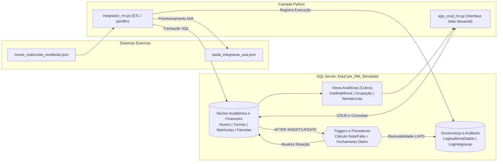
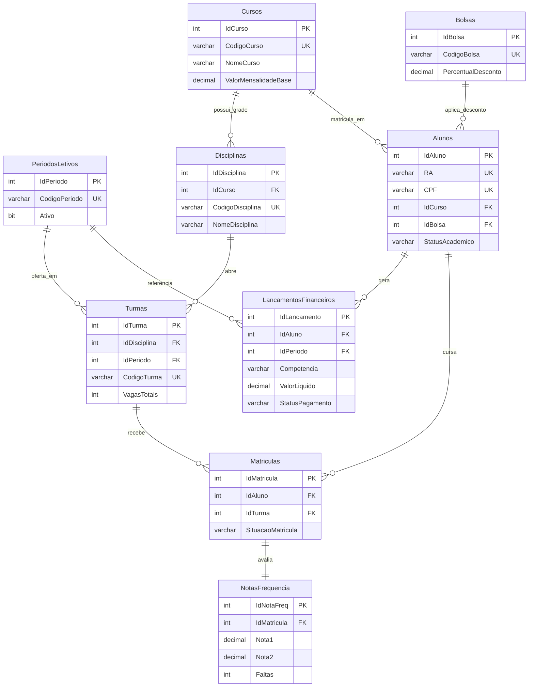

# EduCore RM — Simulador de Núcleo Acadêmico, Financeiro e Integração

Projeto prático desenvolvido em **SQL Server (T-SQL)** e **Python** simulando as rotinas centrais de back-end, regras de negócio, governança de dados e integrações de um ERP educacional inspirado no **TOTVS RM (Educacional e Fluxus)**.

---

## Arquitetura e Equivalência Funcional (TOTVS RM)

| Camada / Objeto | Equivalente no TOTVS RM | Responsabilidade |
| :--- | :--- | :--- |
| `PeriodosLetivos`, `Cursos`, `Disciplinas`, `Turmas` | `SPLETIVO`, `SCURSO`, `SDISCIPLINA`, `STURMA` | Estrutura curricular, oferta de vagas e parametrização de turnos/mensalidades. |
| `Alunos`, `Bolsas`, `Matriculas`, `NotasFrequencia` | `SALUNO`, `SBOLSA`, `SMATRICPL`, `SNOTAETAPA` | Gestão discente, regras de bolsas/convênios, enturmação e apuração de notas/faltas. |
| `LancamentosFinanceiros` | `FLAN` / `SLAN` (RM Fluxus) | Controle de competências, descontos calculados, baixas e inadimplência. |
| `trg_NotasFrequencia_Automacao` | Fórmulas Visuais / Gatilhos | Recálculo automático de frequência mínima (75%) e situação (`Aprovado`, `Reprovado Nota`, `Reprovado Falta`). |
| `sp_ProcessarFechamentoDiario` | RM Job Server / Processos Recorrentes | Rotina transacional em lote para atualização diária de parcelas vencidas. |
| `vw_Cubo_*` e `vw_Regra_Elegibilidade_Rematricula` | Cubos Gerenciais / Relatórios RM | Visões multidimensionais acadêmicas, financeiras, ocupação de salas e trava de rematrícula. |
| `LogAuditoriaDados` e `Roles` (RBAC) | Log de Auditoria (`ZLOG`) e Perfis | Rastreabilidade (`SYSTEM_USER`, `APP_NAME()`, antes/depois) e segregação de acesso (LGPD). |
| `scripts/integrador_rm.py` | Integração via API / Webhooks | Ingestão idempotente de ingressantes do vestibular, geração de parcelas e saída JSON para AVA (Moodle/Canvas). |

---

## Estrutura do Repositório

    ├── sql/
    │   ├── 01_schema_e_seed.sql                 # DDL e carga inicial
    │   ├── 02_seguranca_auditoria_automacao.sql # Triggers, Procedures, Auditoria e RBAC
    │   └── 03_views_relatorios_cubos.sql        # Views analíticas (Cubos)
    ├── scripts/
    │   ├── app_crud_rm.py                       # Interface web (Streamlit)
    │   ├── integrador_rm.py                     # Integração JSON -> SQL Server
    │   ├── novas_matriculas_vestibular.json     # Payload de entrada
    │   └── saida_integracao_ava.json            # Payload de saída (AVA)
    └── requirements.txt                         # Dependências Python
---

## Como Executar Localmente

1. **Banco de Dados (SQL Server 2022 + SSMS):**
   Execute os scripts da pasta `sql/` na ordem numérica (`01` -> `02` -> `03`) na instância local (`localhost\SQLEXPRESS`).

2. **Integração Automatizada (Python 3.10+):**

       pip install -r requirements.txt
       python scripts/integrador_rm.py

---

## Fluxo de Arquitetura e Integração

---

## Diagrama Entidade-Relacionamento (SQL Server)

